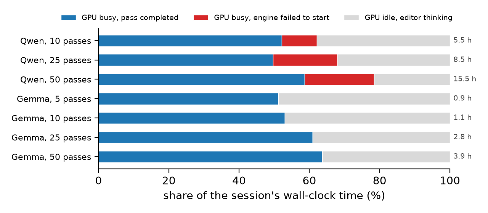
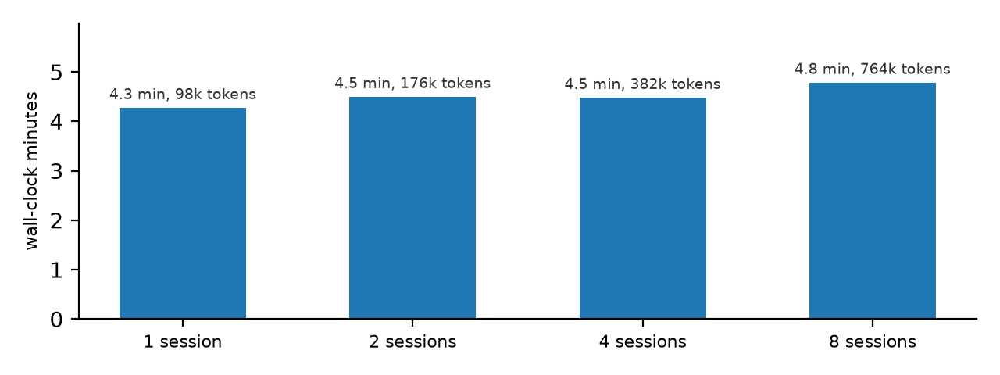

# wspserve

A forward-pass server for weight-space programming (WSP) sessions, and the measurements of the
released [Sparks of WSP](https://rikiyat.github.io/blog/weight-space-programming/) Experiment 8
sessions that it is built from.

In those sessions GPT-6 Astra edits Qwen3.5-0.8B (or Gemma 3 270M) through a Python kernel and
checks its edits with a budget of forward passes. Measured from the released tool logs:

- every one of the 88 edits is a channel scaling or a rank-one projection, and all seven final
  edits rebuild their published hashes bit for bit from 8 bytes to 0.9 MB of factors
- a single session keeps a dedicated GPU 51 to 78% busy, so packing whole sessions onto one GPU
  saves at most 1.27x
- 25 of the 82 Qwen generation passes died while starting a vLLM engine (16 to 27% of each Qwen
  session's GPU time), and 19 to 40% of generated tokens re-sample the unchanged base model



wspserve keeps one model resident and applies each edit as a delta on the rows of the batch that
use it. Both halves of a paired pass run in one batch with the same seeds, base samples are
memoized (exact, since seeds are fixed per problem), teacher-forced probes run between decode
chunks, and a new generation request joins the running batch at the next chunk. It accepts the
request format of the Experiment 8 tool.

## Layout

```
wspserve/       engine.py (model, per-row versions, batched sampling, joining), server.py (HTTP, scheduling, memo), client.py
wspdelta/       exact typed representations of edits, BF16 reconstruction, per-row runtime
tests/          CPU checks for inference, scheduling and the WPB report command
experiments/    workload.py, replay.py, gpu_bench.py, vllm_reference.py, vllm_lora.py,
                compile_released_edits.py, released_edits.py, stop_and_answer.py, loop_direction/
wpb/            WeightProgramBench: exact policy compiler and trivial baselines
results/        every measured number used below
figures/        make_figures.py and its output
```

## Running it

```sh
pip install -e ".[figures,test]"
python -m pytest -q

python -m wspserve.server --port 8765          # downloads the pinned Qwen3.5-0.8B
WSP_SESSION=me python -c "import wspserve.client as W; print(W.forward({'type': 'generate', \
  'model': 'original', 'problems': ['gsm8k_train_0'], 'n': 1, 'max_tokens': 512}))"
```

The server reads the practice problems from `WSP_PRACTICE`, the `exp8_math/practice` folder of
[RikiyaT/lm_understand-logs](https://github.com/RikiyaT/lm_understand-logs) at `4d09ba6d`. The
experiments take that repository's `exp8_math` folder as `--logs`:

```sh
python experiments/workload.py --logs <logs>/exp8_math
python experiments/released_edits.py --logs <logs>/exp8_math
python experiments/replay.py --logs <logs>/exp8_math --modes naive native native2
python experiments/stop_and_answer.py --logs <logs>/exp8_math --model unedited
python figures/make_figures.py
```

On a CUDA GPU, with vLLM in its own environment:

```sh
python experiments/gpu_bench.py --logs <logs>/exp8_math --sessions 1 2 4 8
python experiments/gpu_bench.py --logs <logs>/exp8_math --sessions --paired 64 --out results/paired_pass.json
python experiments/compile_released_edits.py --runs p50c --logs <logs>/exp8_math
python experiments/vllm_reference.py --practice <logs>/exp8_math/practice --prompts 64
python experiments/vllm_lora.py --practice <logs>/exp8_math/practice --adapter results/adapters/p50c
```

## Numbers so far

On one H100 (PyTorch 2.8, transformers 5.22.2, flash-linear-attention 0.4.2, the reference
PyTorch convolution), replaying the first eight requests of released sessions at once, with
8 problems per pass and 2,048 tokens per answer:

| sessions at once | wall time | generated tokens | longest probe wait |
|---|---|---|---|
| 1 | 256.5 s | 98,304 | 0 s |
| 2 | 269.9 s | 176,347 | 0.8 s |
| 4 | 268.8 s | 381,824 | 0.08 s |
| 8 | 287.1 s | 763,812 | 0.73 s |



The sessions are p50c, p25c and p10c in turn, and copies of a session work on disjoint
problems, so every memo hit is a session reusing its own base samples
(`experiments/gpu_bench.py`, `results/gpu_bench.json`). A decode step takes 20 ms with 8 rows
and 24 ms with 128, which is why the batches stack almost for free.

The replay is small (8 problems per pass, 2,048 tokens), and at that size a 0.8B model leaves
the GPU mostly idle. The released logs show the same at full size: at 32,768 tokens the median
Qwen pass with 128 answers took 986 s (22 passes), with 256 answers 950 s (16 passes) and with
512 answers 1,316 s (9 passes).

vLLM 0.33 on the same GPU (`experiments/vllm_reference.py`, `vllm_lora.py`, `lora_fidelity.py`):

- engine start 119 s the first time, 54 s with a warm compile cache
- the p50c edit as a rank-one LoRA adapter (`compile_released_edits.py`, 37 KB) in the same batch
  as the base model: a paired pass of 64 practice problems at 2,048 tokens takes 18.3 s, against
  71.5 s for wspserve (`results/paired_pass.json`, loop stop off)
- a new adapter's first request takes 19 to 24 ms, a plain one-token request 27 ms
- on 16 traces sampled from the base model (24,576 generated tokens), the per-token log-probability
  shifts caused by the adapter correlate at 0.968 with those of the exact edit computed by
  wspserve, the mean absolute difference between the two shifts is 0.016 nats against 0.011 between
  the two engines on the base model, and all 356 shifts larger than 0.5 nats agree in sign
- at 8,192 tokens, over two runs of the 64 problems, adapter rows answered 36 of 128 correctly,
  base rows 13
- a full-size paired pass, 64 problems with both halves at 32,768 tokens: 345.9 s for 2.81M
  tokens, adapter rows 44 of 64 correct (6 at the cap), base rows 10 of 64 (55 at the cap), and
  the edited half alone, which is what the memo leaves, 154.7 s with 42 of 64 correct
  (`results/vllm_lora_32768.json`). The logged passes with 128 answers generated a median of
  2.95M tokens in 986 s

Not done yet: this scheduling on top of vLLM's multi-LoRA path, and whole sessions at their real
length.

On an Apple M4 Pro, replaying the first eight requests of the released p50c session takes 494 s
with wspserve against 957 s for the original design (engine rebuilt per pass, halves run one
after the other, no memo). Most of the gain is the memo. Rows that join a running batch decode
exactly as they do alone in float32 (tests), and every BF16 difference found falls on a tied
logit.

`experiments/stop_and_answer.py` and `experiments/loop_direction/` look at the released p50c
edit. Their results agree with earlier analyses by
[hedwigai](https://www.hedwigai.com/blog/weight-edit-math-or-loops),
[Carlos Toledo](https://carlostoledo.co/reports/weight-space-programming.html),
[OpenWSP](https://github.com/openwsp/openwsp),
[Yiqun Zhang](https://zhangyiqun018.github.io/rethinking-weight-space-programming/) and
[EditLens](https://xxlya.github.io/editlens/).

## WeightProgramBench reproduction

[wpb/README.md](wpb/README.md) gives the pinned dataset download, replay dependencies and
commands for the official scorer. The published results include
[49 held-out-game policy scores](results/wpb/official_baselines.json),
[all 2,219 training-game outcomes](results/wpb/official_baselines_train100.json) (317 games,
seven trivial policies, 100 episodes each, including three recorded scorer errors), and the
[per-game summary](results/wpb/train_trivial.json). The hand-written policy submissions
are in [results/wpb/policies/](results/wpb/policies/).

## Data and licenses

Code: MIT. Files in `results/` derived from the Sparks of WSP logs carry their CC BY 4.0 license.
WeightProgramBench: [neilkale/WeightProgramBench](https://huggingface.co/datasets/neilkale/WeightProgramBench)
at `cb8d15ea`. Not affiliated with the authors of either.
